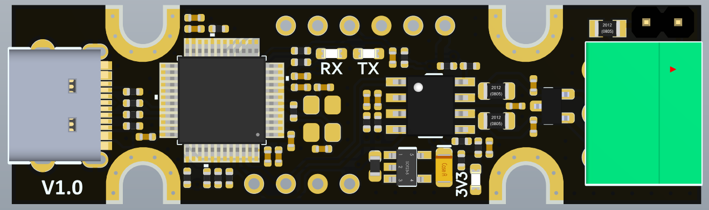

# UCAN



UCAN is an open source USB-to-CAN interface board, based on STM32F072 and candleLight open source firmware, and supports linux/win/mac multi-platform.

# Feature

- Supports CAN2.0A and B, baud rates up to 1M
- Compatible with candleLigtht V1 hardware pin assignment
- Native socketcan support with candleLight firmware
- 3-pin screw plug terminal: CANH, CANL,  GND
- Headers to enter bootloader for firmware updates and SWD interface
- Headers to CAN interface before transceiver
- Headers to enable/disable termination，On-board termination resistors（2 x 59R） are used by default

# Firmware

## Introduction

The FYSETC UCAN uses an STM32F072CBT6 microcontroller. If you want to use it as a USB-to-CAN adapter with Klipper, you can flash it with candleLight firmware.

This guide explains how to do that using a Raspberry Pi connected over SSH. It does not require a Windows PC or the original FYSETC flashing website.

Once flashed, the UCAN is recognised by Linux using the `gs_usb` driver and appears as a SocketCAN interface (normally `can0`).

**Important:** This guide is for candleLight USB-to-CAN firmware. It is not for Klipper's USB-to-CAN bridge firmware.

## Requirements

- FYSETC UCAN
- Raspberry Pi running Raspberry Pi OS or another suitable Linux distribution
- SSH access to the Pi
- USB cable to connect the UCAN
- candleLight firmware binary: `candleLight_fw.bin`
- Jumper wire for temporarily connecting BOOT0 to 3.3V

## 1. Download and prepare the firmware

Download the candleLight firmware package and extract it. (https://github.com/candle-usb/candleLight_fw/releases)

The firmware file used in this procedure was:

`bin/candleLight_fw.bin`

Copy the binary onto the Raspberry Pi. For example, if you have transferred it to your home directory, check that it is there:

```bash
ls -lh ~/candleLight_fw.bin
```

The file used in this procedure was approximately 128 KB.

**Firmware selection matters:** Make sure you use the candleLight binary intended for the STM32F072xB hardware, rather than a binary intended for the STM32F042 CANable hardware.

## 2. Install dfu-util

Connect to the Raspberry Pi over SSH and install the DFU utility:

```bash
sudo apt update
sudo apt install dfu-util
```

Check that it is installed:

```bash
dfu-util --version
```

## 3. Put the UCAN into DFU bootloader mode

The UCAN must be placed into its STM32 bootloader mode before flashing.

1. Disconnect the UCAN from USB.
2. Locate the BOOT0 and 3.3V connections on the UCAN.
3. Temporarily connect BOOT0 to 3.3V.
4. While BOOT0 is connected to 3.3V, plug the UCAN into the Raspberry Pi's USB port.
5. The Pi should detect the STM32 DFU bootloader.

Check detection:

```bash
lsusb
```

You should see an entry similar to:

```text
0483:df11 STMicroelectronics STM Device in DFU Mode
```

You can also check the available DFU interfaces:

```bash
sudo dfu-util -l
```

The output should include an internal flash interface similar to:

```text
Found DFU: [0483:df11] ... alt=0, name="@Internal Flash /0x08000000/064*0002Kg"
```

This confirms that the STM32 bootloader is accessible and that internal flash starts at `0x08000000`.

**Important:** Use the internal flash interface (`-a 0`). Do not select or write to the option bytes interface.

## 4. Flash candleLight firmware

With the UCAN still connected in DFU mode, run:

```bash
sudo dfu-util -d 0483:df11 -a 0 -s 0x08000000:leave -D ~/candleLight_fw.bin
```

What the command does:

- `-d 0483:df11` selects the STM32 DFU device.
- `-a 0` selects the internal flash interface.
- `-s 0x08000000:leave` sets the flash address and requests the device leave DFU mode after flashing.
- `-D ~/candleLight_fw.bin` specifies the firmware file.

You should see the erase and download operations complete:

```text
Erase done.
Download done.
File downloaded successfully
Submitting leave request...
```

**A note about the final message:** In our procedure, `dfu-util` displayed an error during `get_status` after reporting that the file had downloaded successfully. This did not prevent the firmware from working. The important check is whether the device subsequently boots into candleLight mode.

You may also see a warning about an invalid DFU suffix signature. This warning alone does not mean the firmware is unusable.

## 5. Restart the UCAN in normal mode

After flashing:

1. Disconnect the UCAN from USB.
2. Remove the temporary BOOT0-to-3.3V connection.
3. Reconnect the UCAN normally, without BOOT0 held high.

Check the USB device:

```bash
lsusb
```

The expected candleLight USB identity is:

```text
1d50:606f
```

You should see something similar to:

```text
Product: candleLight USB to CAN adapter
Manufacturer: bytewerk
```

Check the kernel messages:

```bash
dmesg | tail -30
```

A successful detection should include lines similar to:

```text
idVendor=1d50, idProduct=606f
Product: candleLight USB to CAN adapter
Manufacturer: bytewerk
gs_usb ... Configuring for 1 interfaces
```

The `gs_usb` message confirms that Linux has loaded the correct driver for the adapter.

## 6. Check the CAN network interface

Now check whether Linux has created the CAN interface:

```bash
ip link show
```

You should see an interface named `can0`, similar to:

```text
can0: <NOARP,UP,LOWER_UP,ECHO> mtu 16
    link/can
```

Check its detailed configuration:

```bash
ip -details link show can0
```

In our case, the output showed:

```text
can state ERROR-ACTIVE
bitrate 1000000
```

This confirmed that the UCAN was configured for 1 Mbps.

`ERROR-ACTIVE` is the normal CAN controller operating state. It does not indicate a fault by itself.

## 7. Check for Klipper CAN devices

If Klipper is installed on the Raspberry Pi, use its CAN bus query script:

```bash
~/klippy-env/bin/python ~/klipper/scripts/canbus_query.py can0
```

If other compatible Klipper CAN devices are connected and communicating on the bus, their UUIDs should be reported.

For example:

```text
Found canbus_uuid=xxxxxxxxxxxxxxxx
Total 1 uuids found
```

If the result is:

```text
Total 0 uuids found
```

the UCAN may still be working correctly. It simply means that no Klipper devices were discovered on the CAN bus.

Check that:

- Another CAN device is connected.
- The printer and CAN devices are powered.
- CAN-H and CAN-L are connected correctly.
- The bus has appropriate termination.
- All devices are configured for the same bitrate.

## Final result

The FYSETC UCAN should now be running candleLight firmware and recognised by Linux as a USB-to-CAN adapter.

The successful checks in this procedure were:

| Check | Result |
|---|---|
| STM32 DFU bootloader detected | Passed |
| Firmware erase and download | Passed |
| CandleLight USB identity `1d50:606f` | Passed |
| Linux `gs_usb` driver loaded | Passed |
| `can0` interface created | Passed |
| CAN bitrate | 1 Mbps |
| Klipper CAN device discovery | Requires another CAN device on the bus |

This provides a way to recover and use the FYSETC UCAN without relying on the original FYSETC flashing website.

---

**Useful commands at a glance**

```bash
sudo apt update
sudo apt install dfu-util

lsusb
sudo dfu-util -l

sudo dfu-util -d 0483:df11 -a 0 -s 0x08000000:leave -D ~/candleLight_fw.bin

lsusb
dmesg | tail -30

ip link show
ip -details link show can0

~/klippy-env/bin/python ~/klipper/scripts/canbus_query.py can0
```
